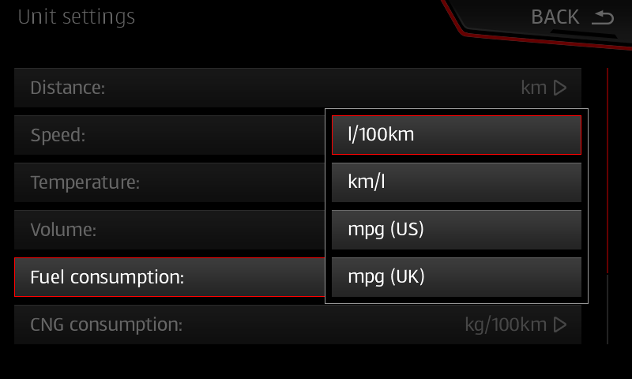
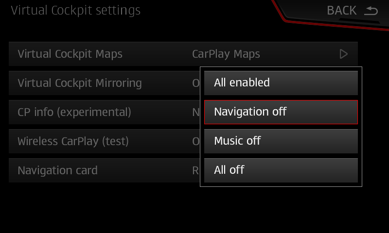
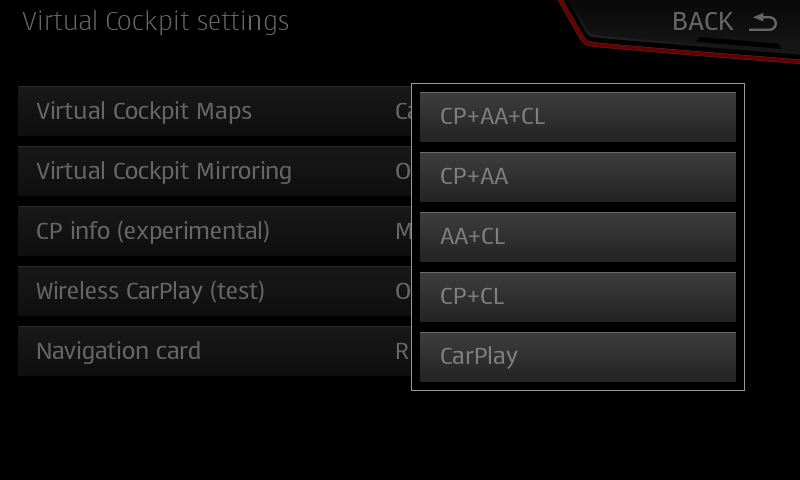
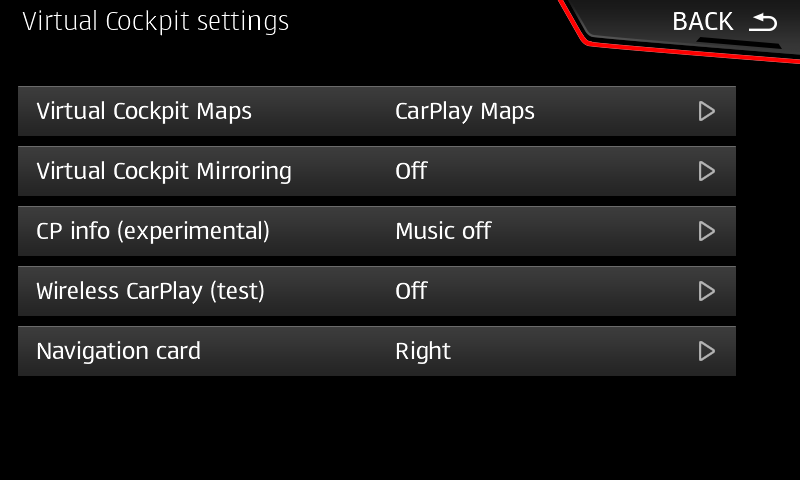
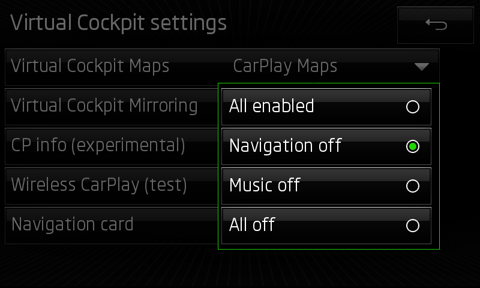
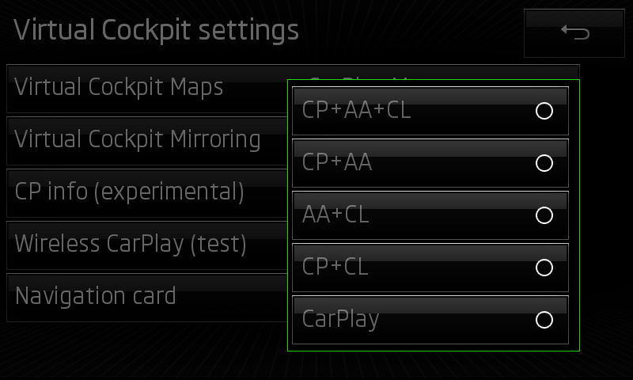

# V2.1 rc.7 experimental validation / 试验版检查记录

Date: 2026-11-04. **Experimental prerelease, not a stable or vehicle-accepted build.**
This report contains no private device IDs, keys, original firmware or raw customer logs.

**Publication decision / 发布决定：** 作者随后明确同意先发布试验预发布版，并保留
所有已知风险说明。稳定版 2.0.1 不变；下文曾提到的发布暂停是当时的历史状态，
不是内核停止已修复或稳定性通过的结论。The author subsequently approved an
experimental prerelease with unresolved issues disclosed. Earlier hold statements
below describe the decision at that time, not a resolved fault or stability pass.

**新增失败证据：** 后续历史 menu13／info11 诊断分支再次出现两次内核异常，
分别在最后约 15:57 和 20:22 心跳之后；两次都在异常打印前保存完整物理内存。
第二次另保存按实际 CPU 选择读取的地址转换和故障寄存器。原始转储、固件和
日志只保留本地，不公开。异常类型与最早会话并不完全相同，尚未证明具有共同
根因。最新 menu17 的正向菜单测试不能抹去这些失败，也不能证明问题只在旧菜单
或模拟器。诊断结束后恢复并独立核对当前候选盘及原有设置。
Two later historical-menu13/info11 diagnostic sessions encountered kernel faults
after their last approximately 15:57 and 20:22 heartbeats. Full physical-memory
snapshots were preserved before diagnostic printing; the latter also captured
actual CPU-selected MMU/fault registers. Raw cores, firmware and logs remain
private. Their fault signatures differ from the first observation, so a shared
root cause is not established. Positive current-menu17 tests do not erase these
failures or prove that they are confined to old menus or the emulator. The current
candidate and original preferences were restored and independently verified.

新增的并发测试门禁已随五个精确固件目标重新构建执行，48 个类加载校验、29 项
注入行为检查和 12 项 ETA 检查均通过；生成的信息 JAR 与前一候选版本逐字节相同。
这是测试覆盖增加，不是用一次重新编译冒充运行时故障已经修复。
The concurrency gate has also run inside a fresh five-target build. All 48 class
checks, 29 injected behaviour checks and 12 ETA checks per target passed; every
information JAR is byte-identical to the previous candidate. Test coverage was
extended; this rebuild is not a runtime fix for the unresolved stop.

另一轮历史菜单复现观察 20 分钟未再出现内核停止，但定时点击中途被原厂欢迎页
打断，该次四项测试不计通过。关闭欢迎页后的独立重试完成四项实际点击和保存。
测试工具已增加真实弹窗边界检查，前台页面被替换时停止，不继续误点。七张真实
截图与中断回放分别验证了这条保护；回放不冒充原生执行。
A separate 20-minute historical-menu observation did not reproduce the kernel
stop. The timed four-choice check was interrupted by the OEM Welcome page and
is not counted as passed; a separate guarded retry completed all four native
click/save actions. Actual popup-border checks now stop the test before option
clicks on an unexpected foreground page. Seven real frames and a mocked
interruption replay validate that test guard separately; the replay is not a
native run.

随后历史 menu13／info11 的连续压力重试完成 20 轮、80 次实际选项切换，逐次检查
保存内容、CRC、序号递增及地图／镜像字段不变，末尾四项弹窗完整。整轮观察约
30 分钟未复现内核停止。此前被欢迎页打断的尝试另行保留，不算 20 轮通过的一部分。
原定 128 KiB 诊断日志容量上限保留；日志停止追加后，实际设置仍继续正确保存。
结束后已恢复当前 menu17／info11 和原有设置。这仍是旧菜单复现分支的有界结果，
不是最新菜单的 80 次验收，也没有确定原始停止的原因。
A subsequent historical-menu13/info11 stress retry completed 20 cycles and 80
native option selections, checking saved values, CRC, generation increments and
unchanged map/mirror fields after each choice. The late four-item popup was
intact, and the approximately 30-minute observation did not reproduce the stop.
The earlier Welcome-interrupted attempt is retained separately, not counted
among the 20 passed cycles. The intended 128 KiB diagnostic-log cap remains;
actual preferences continued to save correctly after log appends stopped.
The current menu17/info11 candidate and original preferences were restored.
This bounded historical-menu result is not an 80-choice acceptance of the latest
menu and does not determine the original stop's cause.

诊断中还发现原有简化离线读取工具只读取文件系统第一份超级块，可能读到较旧
的设置。独立工具校验两份校验和并选择较新有效版本后，确认恢复副本的六字段
及 CRC 与之前实际读值一致，并非安装器丢失设置。四份停止状态的 APP 副本也
已按双视图独立核对，菜单、信息 JAR 和启动引用符合预期，源盘未修改。重新
检查两份视图的诊断文件后，仅找到此前相同的媒体快照，没有新增内核转储；
这仍不能证明故障当时不存在易失内存中的证据。
The minimal offline filesystem reader was found to read only the first
superblock, potentially returning stale preferences. An independent reader
checking both checksums and selecting the newer valid view confirmed the
restored candidate's six fields and CRC match the prior live read, rather than
an installer persistence loss. Both APP views in four stopped images were
independently audited for exact JARs and startup references without modifying
the source images. Both-view diagnostic scans found only the already-known
media snapshot, not a new kernel core. This does not rule out evidence that
existed only in volatile memory at failure time.

信息调度代码另补了真实多线程宿主测试：消费者暂停时同时发出请求，再让独立
消费线程与生产线程并行，注入入队失败，最后核对实际注册目标。10 个全新 JVM
合计完成 640,000 次调度请求，待执行队列不超过 5 项，没有在错误线程调用测试
接收端，最终目标注册结果正确。这里执行的是实际调度源码，但原厂 DSI 是测试
替身；这些结果不等于 QNX／实车通过，也没有证明与内核停止的因果关系。
An additional concurrent host test exercises the production dispatcher with a
held consumer, simultaneous producers, an independent draining thread, injected
enqueue failures and a final actual-attachment check. Ten fresh JVMs completed
640,000 defer requests with at most five queued jobs and no wrong-thread calls
to the fixture receiver. The OEM DSI is a test double; this is not QNX or vehicle
acceptance and does not determine the cause of the kernel stop.

后续同盘单变量对照仅移除信息 JAR 的启动引用，保留相同菜单和初始文件系统状态。
信息模块加载／不加载各观察 15 分钟，两组均完成四项菜单点击与保存，均未复现内核停止。
这只能说明本轮未复现，不能证明信息模块无关、虚拟机独有或问题已经修复。
The same-state information-loaded/unloaded pair completed 15 minutes of observation
per case and all four native save actions without reproducing the stop. This is
bounded non-reproduction evidence, **not a root-cause determination or stability pass**.

为复核最早发生停止时使用的菜单代码，另在可回退的虚拟机副本恢复 menu13，
保留 info11，并完成四档信息开关的实际点击和保存。该轮观察 30 分钟未复现，
末尾原生四项弹窗显示正常，配置 CRC 一致。初始持久数据不是最早故障轮的
逐字节快照，期间也并行运行了宿主测试，因此不视为严格故障复现或性能测试。
结束后已恢复并逐字节核对 menu17/info11；历史菜单没有混入当前候选版。
An isolated historical-menu13/info11 reproduction derivative completed four native
save actions and 30 minutes without that kernel stop. Its late four-item popup
and saved-state CRC were checked. It did not use the original failure's exact
initial persistent snapshot, and host tests ran concurrently; this is neither
strict fault reproduction nor a performance benchmark. The current menu17/info11
candidate was restored and byte-verified afterward. Publication remains on hold.

随后同初始状态的加载分支再观察 20 分钟，完成 48 次原生信息选项点击、保存、
CRC 与递增序号检查，仍未复现。该轮使用 menu15／info11，与前述对照保持一致；
不冒充为最新 menu17 的 SEAT 原生验收，也不据此解除发布暂停。
A further 20-minute information-enabled observation completed 48 native saves
with CRC/generation checks without reproducing the stop. It used menu15/info11
to keep the isolation baseline fixed; it is not final menu17 SEAT acceptance.

最新 menu17／info11 随后在 SEAT 原生英文界面完成四项信息点击保存、四类弹窗边界
和八项连续滚动核对，以及五轮实际原厂视图销毁／重建，设置保持一致。
该会话观察 20 分钟未复现内核停止，期间包含一次健康状态的只读内存通道检查，
不是无干预长时对照，不能据此查明原异常原因或解除发布暂停。
The exact menu17/info11 SEAT build subsequently passed all four native information
save actions, popup bounds, eight-choice scrolling and five actual OEM view
detach/re-entry cycles with preferences retained. Its 20-minute observation did
not reproduce the stop, but included a read-only healthy memory-channel check;
it is not an intervention-free control or a root-cause determination.

随后完整停止／启动，六个配置字段和 CRC 完全一致；但该轮原厂媒体服务未就绪，
出现媒体域超时、`mm-renderer` DEAD 输出与 OOC 重置请求，菜单显示验收未完成。
该失败现场已保存，不计为重启后界面通过。最早的媒体域超时先于本轮进程盘点命令；
原因尚未确定，也不能与先前内核停止直接等同。已另开同持久数据的原厂 APP 对照。
A subsequent full stop/start retained all six preference fields and CRC, but the
OEM media service did not become ready: media-domain timeout, mm-renderer DEAD
output and OOC reset requests were observed. Post-restart visual acceptance is
not passed. The first media timeout preceded that run's process-inventory command.
This is a separate unresolved startup observation, not proof of the original
kernel-stop cause. An original-brand APP control preserving non-APP state was run
as described below.

同一份持久数据上的原厂 APP 对照随后完成 20 分钟，原厂收音机与油耗弹窗正常，
未出现该媒体域超时或内核停止。APP 文件比对的 6,234 项中有 38 处预期差异，
原厂媒体可执行文件的字节和权限未变；这不能排除运行环境、调用或时序影响。
恢复候选版再次冷启动后，15 分钟观察、六字段及 CRC 保留、菜单与四项弹窗显示
均正常。它是一轮通过的重试，不能抹去前一轮失败，也未解除发布暂停。

该失败轮留下的原厂媒体看门狗快照已从保存的虚拟机副本提取，PID 和 UART
记录对应。快照 PC 位于本机原厂 libc 的 MsgSendv，带有媒体配置文件路径的
消息正在等待原厂闪存服务回复。why/what 为零，不把该快照当成 CPU 异常转储。
进程列表中的大量 DEAD 行也不能当成反复崩溃次数。这里只记录等待位置，尚未
证明触发原因或与最初内核停止的关联。原始固件、核心文件和诊断日志均只保留本地。
QNX 本身支持[按进程请求快照](https://qnx.com/developers/docs/6.5.0SP1.update/com.qnx.doc.neutrino_utilities/d/dumper.html)，
因此仅有 core 文件不能等同于一次处理器故障。

The same-persistence original-APP control then completed 20 minutes with working
radio and native Fuel consumption UI, without that media timeout or a kernel
stop. An offline APP inventory found 38 expected differences among 6,234 candidate
entries; the OEM media executable's bytes and mode were unchanged. This does not
rule out environment, calling or scheduling effects. Restoring the candidate and
repeating a cold start completed 15 minutes with all six preference fields/CRC,
the native menu and four-item popup intact. One positive repeat does not erase
the failed observation or clear publication hold.

The failed run's media-watchdog process snapshot was recovered from the preserved
emulator copy and correlated to its UART PID. Its PC maps to the actual OEM
libc MsgSendv; the message contains a media-configuration path and the captured
thread awaits the native flash service. Snapshot why/what are zero. This is a
wait-location lead, not evidence of a CPU fault or its initiating cause. Repeated
DEAD lines in a process listing are not a count of repeated crashes. The snapshot
does not resolve the original kernel stop. Raw firmware, cores and logs stay local.

另补充 G11 卡片启动传输测试：MU1433、MU1447 各四个位置，分别覆盖已有设置、
设置文件延后出现、主文件损坏后读取备份，共 24 个独立宿主进程；实际调用生产
声明构造、READY、轮询和异步回调代码，并检查重连无需再次点选、单次串行命令、
状态文件不被改写及 CF 引用释放。ASan/UBSan 全部通过，原有四项声明／传输
回归也通过。接收端仍是异步替身，不是 iPhone 或 MOST 仪表，因此不宣称解决
了 olli991 反馈的实车重启应用或昼夜显示问题。运行方式（Linux 宿主）：

```sh
python3 tests/test_v21_card_startup_transport.py
```

Additional G11 startup-transport coverage runs 24 fresh host processes across
MU1433/MU1447, four positions and existing/late/backup-recovered preferences. It
calls the production declaration, READY, polling and asynchronous callback bodies;
reconnect reapplies the saved scene without another UI selection. State-file
preservation, serialized sends and CF ownership pass ASan/UBSan, together with
four existing declaration/transport regressions. The receiver is an asynchronous
test double, not an iPhone or MOST cluster. These checks do not resolve the
reported physical boot-reapply or day/night observations.

## 中文

本次只做本地离线构建与虚拟机测试，没有连接、刷写或重启真实车机。
完整传统 MQB Toolbox 为唯一公开安装包，独立安装实验包与私有 V7.x 不发布。

| 检查 | 结果与边界 |
| --- | --- |
| 精确固件 API | MU1102、MU1367、MU1440、MU1433、MU1447 分别编译；每个信息 JAR 的 48 个类通过 JVM 加载校验 |
| 信息开关与 ETA | 每个目标执行 29 项实际注入行为检查、12 项冬夏令时 ETA 检查；不等于真实手机输出 |
| 多国语言 | 保留 31 种菜单语言；G11 使用窄条缩写并保留试验标记，字形仍取决于原厂字体 |
| 原厂菜单几何 | 每个固件 5,034 组边界检查，覆盖 G11 原厂负间距和子列表纵向偏移；SEAT 主选项条扫描位置与原车一致，四项弹窗外框同为 `(411,137,334,248)`，右侧选项未裁切 |
| 可重复构建 | 20 个菜单／按键／帧率／信息 JAR 的类内容一致；四个原生信息辅助程序和两种 G11 核心字节一致 |
| 安装事务 | 七种配置覆盖全新安装、更新、导航补齐、损坏、未知包装器拒绝、提交失败回退和原厂恢复 |
| 本地候选 ZIP | rc.6 重新生成后完成九组 Linux 检查及 Windows／Linux 各 147 项解包脚本操作，七套清单、CRC/SHA-256 通过。Linux 首轮因宿主全局同步等待 FUSE 超时未计通过；测试工具改为真实同步临时目录所在文件系统后重跑通过，车辆脚本的 sync 未改 |
| 无关工具箱文件 | 与已发布 2.0.1 比较，305 个无关 MQB 文件逐字节不变 |
| SEAT 原生界面 | 自身 G11 800×480 固件界面，四项信息选项实际点击并保存，完整停止／启动虚拟机后仍保留 |
| 最新构建重启边界 | 一轮媒体启动异常保留；原厂 APP 对照 20 分钟未复现，恢复候选版重试 15 分钟通过六字段／CRC 和实际菜单／弹窗显示。重试通过不抹去失败或确认根因 |
| Škoda 原生界面 | 自身英文 G11 界面完成四项信息开关点击／保存和八项原生滚动；修正弹窗背景未计入原厂子列表 Y=21 的问题。四项外框高度 328、五行可见列表高度 394，最后一行完整位于背景内；不等于实车验证 |
| 虚拟机长时运行 | 一次 SEAT 候选会话在最后 8 分 16 秒心跳、随后约 8 分 31 秒日志标记后出现 QNX 内核停止，随后中断事件耗尽；原品牌 APP 对照超过 12 分钟未复现，并实际打开油耗弹窗。根因未隔离，不列为稳定性通过，也不凭转储中的进程名归因 |
| 实车输出 | 新信息模块的真实手机／MOST 仪表验收尚未完成，不保证所有车型、封面、长期重连或可见帧率 |

信息模块测试中确实发现了后台线程直接调用原厂 DSI 的问题。修正后，导航初始化、
清理、当前帧刷新、BAP 刷新和音乐监听注册通过最多五个合并任务进入 ASL 原线程；
队列接收不代表注册成功。最终 SEAT 原生点击和重启检查中未再出现该类线程错误
或 Java 链接错误。虚拟机不具备的 DSI 接口另行记录，不把“没有真实接口”写成成功。

下列图片来自本地原厂固件虚拟机，**不是实车，也不是网页仿制菜单**。

原车“单位设置 → 油耗”的四项弹窗作为对照。修正保留原厂列表内边距、
按钮偏移和行距，不再把 334 像素的视口误设为 316 像素的单个选项宽度。
八项镜像使用原生连续滚动，展开范围限制在本品牌内容区域，不带入大众大屏坐标。







上面信息四项和八项滚动截图均来自本轮 menu17 原生测试。下方完整重启记忆截图
仍是较早的 menu13 会话，不能替代最新构建的独立重启验收；最新重启核对另行记录。
当前构建包含斯柯达原厂负间距和子列表纵向偏移支持，SEAT 的布局参数和保存逻辑未变。



斯柯达本轮修正使用自己的原厂 PushUp 计算方式，背景高度包含子列表纵向偏移，
不套用 SEAT 或大众的外框尺寸。以下为本轮实际原生界面截图：





仍需上机核对：四档信息开关、同一首歌封面重开、反复插拔、卡片左右中关闭和重启
应用、昼夜切换、原厂恢复。SEAT 先前反馈的昼夜外观和开机后卡片需要重新应用的
问题不能仅凭设置文件保存成功宣称修复。AID 12.3 卡片最终参数也不是实车黄金版。
无线 CarPlay 只有默认关闭的保存接口，没有在这个包里发布实际无线服务。

## English

The five firmware targets are built against their exact original APIs. All 48
information classes per target pass JVM verification; each target passes 29
injected behavior cases and 12 ETA cases. Thirty-one menu locales are retained.
Twenty JAR outputs match by class content on repeat builds; the four information
native helpers and both G11 cores are byte-reproducible.

Each firmware also passes 5,034 selector-bound cases, including the older G11
skin's valid negative item spacing and native child-list Y offset. Native SEAT image scans
match the original Units screen's main-row positions and the Fuel consumption
popup's `(411,137,334,248)` outer frame. Options reach the original right edge.
The G11 viewport retains its native padding, width, item/button offsets and
spacing; eight-choice lists scroll continuously within their own content area,
without the Volkswagen large-screen y-coordinate override.

The rebuilt rc.6 local archive completed nine Linux suites and 147 extracted-script
transaction operations on each of Windows and Linux, with profile manifests and
CRC/SHA-256 checks. The first Linux attempt timed out in host-wide sync waiting
for a FUSE filesystem; it is not counted as a pass. The test harness now executes
real GNU sync -f on the temporary fixture filesystem, rather than every host mount;
the shipped QNX sync call is unchanged. The rerun passed. Scope protection compares
all unrelated MQB files byte-for-byte with the published 2.0.1 archive.

SEAT testing uses its own native 800×480 G11 firmware, not a Volkswagen skin.
All four information options were clicked and saved. A complete emulator stop and
start retained all six preference-state fields, and the native menu showed the
saved Music off selection. No wrong-thread DSI or Java linkage diagnostics were
seen in those final checks. Missing simulated DSIs are **not** physical output.

Both the Škoda candidate and its no-information-JAR control eventually reached
SmartLink after slow emulator startup. This is not an established information-
module startup regression. The current corrected Skoda build completed all four
English information clicks/saves and native continuous scrolling. Its original
PushUp includes child-list Y=21 when calculating the enclosing background. The
corrected four-row popup is 328 pixels high and the five-visible-row popup is 394;
the inspected last row lies fully inside the background. These are native emulator,
not physical-cluster, results. The isolated control is not the shipping payload.

One long-running SEAT candidate session stopped in the QNX kernel after its last
8:16 heartbeat and a subsequent approximately 8:31 log marker, followed by
interrupt-event exhaustion. The cause is not
isolated. It is **not** counted as a stability pass, nor attributed to a process
merely because its name appears in the dump. A byte-identical original-brand APP
control without the new menu/information ran for over 12 guest minutes without
that stop and opened its native Fuel consumption popup. This does not establish
an emulator-only or module-only cause. This prerelease therefore makes no
long-running emulator or physical-vehicle stability claim. The information and
continuous-scroll images now show the exact menu17 native test. The cold-restart
image remains from the earlier menu13 session and does not substitute for the
current build's separate restart check. The final build accepts Škoda's native
negative spacing and child-list offset, without changing SEAT layout parameters
or preference persistence.

No real vehicle was connected for this work. Real phone/cluster information,
album-art re-enable, repeated reconnect, visible card placement, day/night and
boot card reapplication remain tester acceptance items. Keep recovery backups;
do not treat this prerelease as a stable compatibility guarantee.

Special thanks to **[olli991](https://github.com/olli991)** for extensive ideas,
practical guidance and detailed testing feedback. Thanks separately to
**[octacon84](https://github.com/octacon84)** for the MU1447 adaptation package
and community testing. [Contribution provenance](COMMUNITY_V2_1_CREDITS.md).
